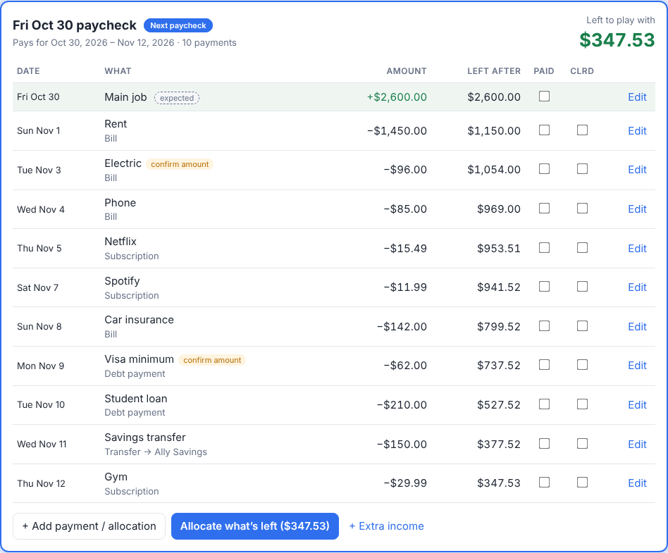

# Paycheck Planner

> **1. It is only a visual aid.** It shows you where your money is going and when. That is all it is designed to do.
> 
> **2. It is not financial advice.** Nothing in this app, this repository, or its website is financial, tax, legal, or investment advice.

Paycheck Planner splits your month by paycheck. For each paycheck it lists everything that comes out before the next one, in date order, with a running "left after" figure, so you can see what each paycheck has to cover, when, and how much is left over.

It is built for the "what does the next two weeks look like?" problem: bills pull money on different days, you are paid every other week, and it is hard to hold it all in your head.

## Features

- **One card per paycheck.** Bills, subscriptions, credit card minimums, and transfers land on the paycheck that comes before their due date. Move or skip any single payment.
- **Date order with a running balance.** See the day it gets tight.
- **Left to play with.** Income minus what is due. Send the leftover to savings, a sinking fund, or an extra debt payment with one click.
- **Whole-month view.** A month with two paychecks is two cards. Your next paycheck is highlighted, and income that has landed is kept separate from income you are only expecting.
- **Sinking funds.** Named buckets (new car, house…) you add to when you choose and pull back from when you need to.
- **Paid and cleared checkboxes** on every payment.
- **Spreadsheet export.** Export any month, plus your bills and funds, to `.xlsx`.
- **Private.** Runs entirely in your browser, offline. No account, no tracking, no data leaves your computer.

It is **not** a bank dashboard. It does not connect to your accounts and does not track balances. You tell it your income schedule and your bills, and it lays them out so you can see them.

## Download

**[Download the latest release](../../releases/latest)** (a small `.zip`), or get it from the [download page](https://phluschott.github.io/financial-htmlapp/).

### Verify your download (recommended)

Compare the SHA-256 fingerprint of the file you downloaded with the one published in the release notes and in [`docs/downloads/SHA256SUMS`](docs/downloads/SHA256SUMS):

| System | Command |
|---|---|
| Windows (PowerShell) | `Get-FileHash .\paycheck-planner-1.0.0.zip -Algorithm SHA256` |
| macOS | `shasum -a 256 paycheck-planner-1.0.0.zip` |
| Linux | `sha256sum paycheck-planner-1.0.0.zip` |

**v1.0.0:** `0da969691b4829e5388416291ba37be704147eb938df4473353e63a3a821746e`

A matching hash shows the file was not corrupted or altered on the way to you. The build is reproducible: running `python3 build.py` on this source produces a zip with the same hash. The app is three small, readable files (`index.html`, `app.js`, `style.css`), so you can also read exactly what it does.

## Getting started

1. Unzip the download into a folder you will keep, such as Documents.
2. Open `index.html` in your browser (double-click it).
3. Follow the short setup: your income, the bills, subscriptions, and debts that pull money on a schedule, and any sinking funds.
4. The **Plan** page opens on your next paycheck.

It needs no internet connection and no installation.

### Saving your data

| Browser | How it saves |
|---|---|
| Chrome, Edge, Opera | Choose the app folder once. The app then autosaves `finance-data.json` into it and keeps timestamped backups in a `backups` folder. You may be asked to allow access each time you open it. |
| Firefox, Safari, others | These browsers cannot write to a folder. Use **Save file** to download your data and **Open a data file** to load it next time. |

Your data file is the only copy of your information, so back it up. It contains your financial details; do not share it or put it anywhere public.

### Password protection (optional)

In **Settings** you can set a password. The data file is then encrypted with AES-256-GCM (key derived with PBKDF2-SHA256, 600,000 iterations) using your browser's built-in cryptography. **There is no password recovery.** If you forget the password, the data cannot be opened. Only the data file is encrypted; the app files are ordinary readable files.

### Privacy

The app ships with a Content-Security-Policy that blocks every network request from the page, and it contains no analytics or third-party code.

## Good to know

- **Visual aid, not advice.** The app does not recommend, evaluate, or approve any financial decision. If you need advice, talk to a qualified professional.
- **Only as accurate as what you enter.** Check amounts and due dates against your own statements.
- Fixed paychecks are assumed to arrive on schedule. Tick **Landed** when the money actually arrives, and use **+ Extra income** for variable or one-off income.
- Changing an amount (like a price increase) applies going forward; past months keep their old values. Deleting a bill or income source removes it from past months too, so mark it inactive to keep your history.
- The software is provided as is, without warranty of any kind.

## For maintainers

See [`RELEASING.md`](RELEASING.md).
